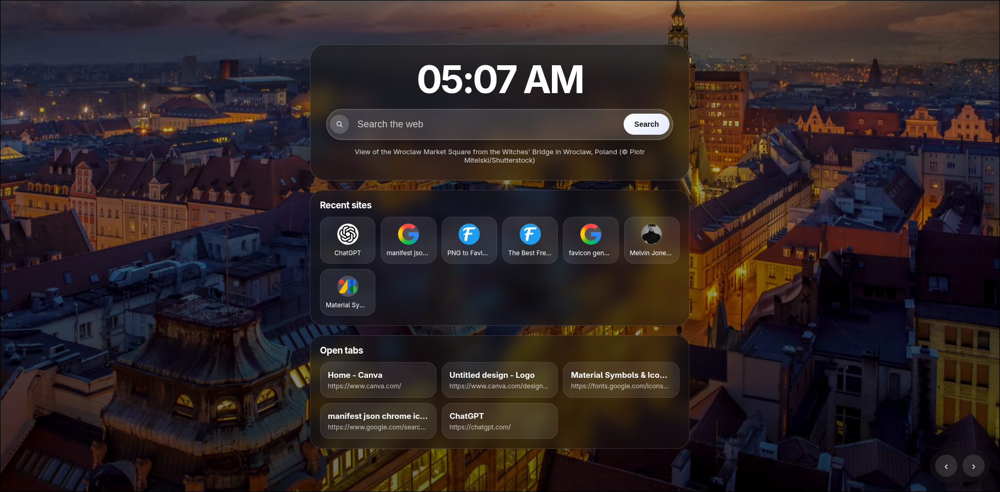

# Awesome New Tab Extension

A modern, customizable browser new tab experience with stunning Bing Wallpaper backgrounds and a clean, immersive design.

## Installation

1. Clone the repository:
   ```bash
   git clone https://github.com/webvium/awesome-new-tab-extension.git --depth 1
   ```
2. Open Chrome and navigate to `chrome://extensions/`.
3. Enable "Developer mode" using the toggle in the top right corner.
4. Click "Load unpacked" and select the cloned repository folder.
5. The extension should now be installed and the awesome new tab page will appear on any webpage.

## License

This project is licensed under the MIT License - see the [LICENSE](LICENSE) file for details.
